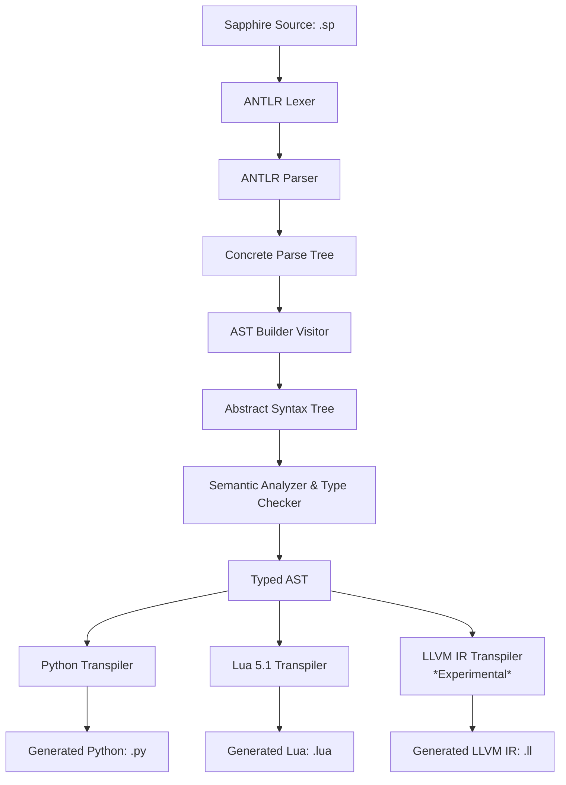

# Compiler pipeline

This document provides a comprehensive technical overview of the implementation of the **Sapphire Compiler**, transpiling Sapphire source code (`.sp`) to executable Python or Lua 5.1.

## Architecture Overview

The Sapphire compiler is structured as a classic multi-stage pipeline supporting multiple code generation targets:



## Stage 1: AST Design & Building

The Concrete Parse Tree generated by ANTLR contains parser-specific nodes (like parentheses, punctuation, and markers) that are redundant for compilation. Stage 1 designs a clean **Abstract Syntax Tree (AST)** and builds it using a visitor.

### 1. AST Node Design (`ast.py`)
All AST node classes inherit from a base `ASTNode` class defined in [ast.py](../sapphire/parser/ast.py):
- **Base Node**: Implements `to_dict()` for recursive JSON serialization, facilitating easy AST debugging and visualization.
- **Type Nodes**: Includes `BasicTypeNode`, `OptionalTypeNode`, `ArrayTypeNode`, `MapTypeNode`, and `FunctionTypeNode` to represent types in the AST.
- **Declarations**: Node classes represent top-level code structures: `ProgramNode`, `StructDeclNode`, `ImplBlockNode` (holding static/const/mutable methods), `FuncDeclNode`, and `TraitDeclNode`.
- **Statements**: Manage block execution and control flow: `VarDeclNode`, `AssignmentNode`, `IfNode` (supporting optional checks), `WhileNode`, `ForNode`, `ReturnNode`, and `ExprStmtNode`.
- **Expressions**: Handle operations: `LiteralNode`, `IdentifierNode`, `BinaryOpNode`, `UnaryOpNode`, `CallNode`, `MemberAccessNode` (supporting optional chaining `?.`), `CloneNode`, `LambdaNode`, `ArrayLiteralNode`, and `IndexExprNode`.

### 2. AST Building Visitor (`ast_builder.py`)
The `ASTBuilder` visitor class defined in [ast_builder.py](../sapphire/parser/ast_builder.py) inherits from ANTLR's generated `SapphireVisitor`:
- It overrides methods corresponding to parser grammar rules (like `visitProgram`, `visitVariableDeclarationStatement`, etc.).
- Converts rule context objects (`ctx`) into strongly-typed `ASTNode` objects.
- Correctly translates grammar alternatives (like `# AdditiveExpr`, `# CallExpr`) into their respective AST nodes.

## Stage 2: Semantic Analysis & Type Checking

Stage 2 enforces Sapphire's safety contracts, resolves lexical scopes, infers types, and validates compile-time constraints.

### 1. Scope & Symbol Management (`symbol_table.py`)
The Symbol Table defined in [symbol_table.py](../sapphire/semantics/symbol_table.py) manages symbols and types:
- **Lexical Scoping**: The `Scope` class maintains variable/type associations locally and points recursively to a parent scope. Entering a block enters a new nested scope; exiting pops it.
- **Shared Namespace**: Structs, functions, and variables all share the same namespace in each scope level, preventing name collisions.
- **Type System**: Standardizes compiler types: `PrimitiveType`, `OptionalType`, `FunctionType`, `StructType`, `TraitType`, and `ArrayType`.
- **Compatibility checking (`is_compatible`)**: Enforces assignability constraints (e.g. allowing assigning `int` to `float`, assigning `none` to an optional type `T?`, and assigning non-optional `T` to `T?` while rejecting reverse optional-to-non-optional casting).

### 2. Semantic analysis rules & modular passes
The `TypeChecker` class in [type_checker.py](../sapphire/semantics/type_checker.py)
orchestrates semantic analysis across modular passes and specialized checkers:
- **Semantic Context (`semantic_context.py`)**: Centralizes typed AST node
  annotations, resolved call signatures, symbol tables, and compiler errors.
- **Declaration Pass (`declaration_pass.py`)**: Handles Pass 0 (imported module
  resolution) and Pass 1 (global struct, enum, trait, and function symbols).
- **Struct Layout Pass (`struct_layout_pass.py`)**: Handles Pass 2, resolving
  static composition layouts, circular inheritance checks, and field copying.
- **Arena & Lifetime Checker (`arena_checker.py`)**: Validates arena allocation
  scope chains, reference lifetimes, and prevents nested arena escapes.
- **Generics & Monomorphization Checker (`generics_checker.py`)**: Manages
  AST parameter substitution, type mangling, and monomorphization.
- **Immutability Checking**: Enforces that constants declared with `let` cannot
  be reassigned.
- **Method & Constructor Safety**:
  - Verifies that methods called on constant objects are marked `const`.
  - Inside the constructor `__init__`, enforces that all non-optional struct
    fields are explicitly initialized.
  - Verifies that mutable reference (`var`) parameters receive mutable lvalues.
- **Conditional Bindings & Optional Safety**: Validates unwrapping
  (`let x ?= optional`) and init statements where variables are registered
  inside the nested control-flow scope.
- **Bidirectional Lambda Inference**: Resolves types of lambda parameters
  without annotations (e.g. `x -> x * 2`) by matching them against expected
  function types (like `(int) -> int`) in assignments or call sites.

## Stage 3: Code Generation & Target Registry

Stage 3 compiles the typed AST into target language code, mapping Sapphire semantics to target runtimes.

### Open/Closed Target Backend Registry (`transpiler_registry.py`)
Target code generators register dynamically with `TranspilerRegistry` in
[transpiler_registry.py](../sapphire/code_gen/transpiler_registry.py) using the
`@TranspilerRegistry.register(aliases=[...], display_name=..., default_extension=...)`
decorator. This decouples code generation dispatch from `transpile_file`,
adhering to the Open/Closed Principle.

### Table-driven intrinsic code generation (`intrinsics.py`)
Built-in primitive and collection operations (`String`, `Array`, `Map`,
`range()`, and `Enum`) are dispatched via a centralized table-driven registry
in [intrinsics.py](../sapphire/code_gen/intrinsics.py). Instead of maintaining large,
repetitive `if/elif` call ladders across backends, `IntrinsicRegistry` maps
`(category, method, target)` to backend-specific emitter functions. Both
`PythonTranspiler` and `LuaTranspiler` delegate intrinsic call handling
directly to `IntrinsicRegistry.try_emit(target, self, node)`. Centralized
detection of built-in standard library modules is provided via
`is_builtin_module(import_path)`.

### Python target (`python_transpiler.py`)

- **Runtime preamble (`python_runtime.py`)**: Defines slotted runtime classes
  (`Arena` with `O(1)` dict-backed registration, `_SapphireCoroutine`,
  `_SapphireRef`, `_SapphireSharedRef`, `_SapphireWeakRef`, `_LazyCoWProxy`,
  `_BoundProxyMethod`) and `SapphireObject`. `SapphireObject` stores own fields
  directly in `__dict__` (without a custom `__setattr__` or separate
  `__shadow__` dictionary) and delegates missing attributes to `__proto__` with
  lazy Copy-on-Write on nested mutations.
- **Structs, copies & deterministic RAII**: Eligible non-proto,
  single-inheritance structs emit `__slots__`, fixed-signature `__init__`
  methods (inlined when neither subclassed nor exported), and type-directed
  value-copy fast paths (`.copy()` / `@staticmethod _sp_copy`). User struct
  destructors emit `def _sapphire_destroy(self):` invoked deterministically by
  `_sapphire_del`, keeping user structs off CPython's GC finalizer queue;
  diamond destruction guards (`_sapphire_destroyed_classes_`) are emitted only
  for diamond-eligible hierarchies.
- **Expressions, coroutines & control flow**: Emits native PEP 701 f-strings,
  walrus-based optional chaining/coalescing (`:=`) without IIFE lambdas,
  hoisted `_sp_gen_*` coroutine generators, tuple membership (`in (...)`) for
  multi-literal `match` arms, deduplicated aliases for byte-identical
  monomorphized functions, cached `_sp_builtins` for `@extern` writes, and
  `test_mode`-gated `_SP_LINE_MAP` tables.
- **Host engine & stdlib interop (`@extern` & `@export`)**: Binds host or
  Python standard library modules with `@extern("module.name")`, maps trait
  method aliases with `@export("method")`, and attaches exported callbacks via
  `@export("target.path")` with safe fallback for cross-backend targets.

### Lua 5.1 target (`lua_transpiler.py`)

- **Runtime preamble (`lua_runtime.py`)**: Caches Lua standard library globals
  at module scope, shares reusable metatables (`_PROTO_MT`, `_COW_MT`,
  `_REF_MT`, `_SHARED_REF_MT`, `_WEAK_REF_MT`) keyed by cross-module
  `_G._SP_K_*` tokens, provides ASCII fast paths and zero-allocation UTF-8
  sizing, and guards the Love2D `love.errorhandler` hook once globally via
  `_G._SP_ERRORHANDLER_INSTALLED` and `_G._SP_LINE_MAPS`.
- **Structs & constructors**: Emits fixed-arity `Struct._new(...)` constructing
  single presized table literals for compiled Sapphire calls (while keeping
  `Struct.init(...)` for Lua interop), flat multi-parent method inheritance via
  `_SP_RT._inherit_multi`, and conditional diamond destructor guards.
- **Collections & indexing**: Maps Sapphire 0-based indexing (`arr[i]`) to
  1-based Lua table indexing with non-optional fast paths
  (`_sapphire_array_at_val`, `_set_val`, `_push_val`, `_get_val`), direct `#arr`
  on plain locals, single-lookup compound index assignments
  (`_sapphire_array_ref` / `_sapphire_map_ref`), and numeric `for` loops.
- **Expressions, multi-return & 200-local hygiene**: Lifts `??`, `?:`, optional
  `?.` chains, optional casts, and `CloneNode` blocks into straight-line
  `local` + `if` statements (avoiding LuaJIT `FNEW`/`UCLO` aborts), flattens
  string `+` chains into single `..` expressions, unboxes multi-return
  `ReturnNode` and multi-yield `MatchExprNode` into multiple locals, uses
  fixed-arity signatures for non-`@export` optional-default functions, wraps
  discarded expression statements in `do local _ = ... end`, and spills modules
  with more than 120 top-level declarations into `local _MOD = {}`.
- **Host engine interop (`@extern` & `@export`)**:
  - `@extern var` declarations omit `local` initializations, leaving variable
    names bound to host global scope (e.g. `love`).
  - `@export("path")` functions generate global Lua definitions (e.g.
    `function love.update(dt) ... end`).
  - Calls on host trait fields (e.g. `love.graphics.rectangle(...)`) transpile
    using dot notation (`.`) rather than colon (`:`) syntax.

### LLVM IR target (experimental – `llvm_transpiler.py`)

- **Experimental native backend**: Defined in
  [llvm_transpiler.py](../sapphire/code_gen/llvm_transpiler.py), this backend
  lowers Sapphire AST nodes directly into LLVM IR text using `llvmlite`.
- **Supported primitive & stack operations**: Handles primitive types
  (`int` -> `i64`, `float` -> `double`, `bool` -> `i1`, `void`), function
  declarations, stack-allocated variables (`alloca`/`load`/`store`), arithmetic
  with implicit promotion, basic block returns, and struct definitions.
- **AOT & JIT foundation**: Lays the foundation for Ahead-Of-Time (AOT) native
  executable compilation via `clang`/`llc` and in-memory JIT execution.
  Unimplemented high-level features raise `NotImplementedError`.

### High-level compiler driver API & error listeners

- **Centralized ANTLR error listener**: Defined in
  [error_listener.py](../sapphire/parser/error_listener.py),
  `CustomErrorListener` captures ANTLR syntax errors and formats detailed
  diagnostics with source code snippets.
- **Domain exception hierarchy**: Defined in
  [errors.py](../sapphire/common/errors.py), standard exceptions
  (`SapphireSyntaxError`, `SapphireTypeError`, `SapphireTranspileError`,
  `SapphireLSPError`) extend `SapphireError` for uniform error reporting.
- **Compiler driver (`transpile_file`)**: The compilation driver function
  `transpile_file(input_file, output_file, target="python", sourcemap=True, verbose=False)`
  in [transpiler.py](../sapphire/code_gen/transpiler.py) orchestrates parsing,
  semantic analysis, and target backend resolution via
  `TranspilerRegistry.get(target)`. Both the `sapphire` CLI
  (`sapphire/cli/sapphire.py`) and test runner (`sapphire/cli/test_runner.py`)
  invoke `transpile_file` directly. Progress logging to `stdout` is gated on
  `verbose=True`, while warnings and errors emit to `stderr` unless
  `quiet=True`.
  - **Shared runtime module**: `use_runtime_module=None` (the default)
    automatically emits a shared `_sapphire_runtime.py` or
    `_sapphire_runtime.lua` module on multi-file builds with local `.sp`
    imports while keeping single-file outputs self-contained.
  - **Stdlib stub protection**: `is_stdlib_stub` skips transpiling `std.*`
    modules and any `.sp` signature stubs under `sapphire/lib/std/` that have
    sibling `.lua`/`.py` runtime files, ensuring hand-written runtime
    implementations are never overwritten.
  - **Isolated `-o` build output**: When `output_file` is explicitly passed
    outside `input_file`'s directory tree, transitive project dependencies are
    emitted relative to the target output directory while prebuilt
    `sapphire/lib/` bindings are reused in place without dirtying library
    directories.

## Stage 4: Source Map Generation & Love2D Debugging

When targeting Lua/Love2D, Sapphire generates v3 source maps (`.lua.map`) and embeds runtime stack-trace demanglers.

### 1. Source Map Builder (`source_map.py`)
- **V3 JSON Specification**: Implements Base64 VLQ (Variable-Length Quantity) encoding to format standard Source Map V3 JSON files containing `version`, `sources`, `sourcesContent`, and `mappings`.
- **Offline & IDE Debugging**: `.lua.map` sidecar files allow IDEs (such as VS Code) to set breakpoints and map runtime Lua execution back to Sapphire `.sp` source files without affecting game load times or RAM.

### 2. Runtime Stack-Trace Demangler & Love2D Error Screen
- **Inline Line Mapping Table**: Transpiled Lua code includes a compact `_SP_LINE_MAP` lookup table mapping generated Lua line numbers to original `.sp` files, line numbers, and source line snippets.
- **Love2D Crash Overlay Hook**: Overrides `love.errorhandler` and intercepts stack trace strings. When a runtime crash occurs in Love2D (e.g. missing asset, out-of-bounds index, or failed unwrap), both the terminal logs and Love2D's graphical error screen display demangled Sapphire `.sp` filenames, line numbers, and source code line snippets.
- **CLI Options**: Enabled by default for Lua transpilation. Can be disabled for production release builds using the `--no_sourcemap` CLI flag.

## Backend performance characteristics & benchmarking

Although the Python and Lua 5.1 backends implement identical Sapphire semantics,
their runtime performance profiles differ sharply because of the underlying VMs.

### Why LuaJIT outperforms CPython on compute and allocation loops

- **Register-based vs. stack-based bytecode**: Lua 5.1 / LuaJIT is a
  register-based VM (a single `ADD a, b, c` instruction operates directly on
  frame slots, backed by LuaJIT's hand-tuned `DynASM` assembly interpreter),
  whereas CPython is a stack-based VM (`LOAD_FAST`, `BINARY_OP`, `STORE_FAST`).
  Even on interpreter fallback paths (such as `coroutine.resume`), LuaJIT
  typically holds a 2x–5x advantage.
- **Tracing JIT & allocation sinking**: LuaJIT records hot loops into SSA IR,
  inlines fixed-arity constructors (`Struct._new`), and applies escape analysis
  with allocation sinking and load/store forwarding. Short-lived struct tables
  in hot loops can be eliminated completely into native register arithmetic.
  CPython (including 3.14's specializing adaptive interpreter) does not sink
  heap allocations across Python calls, so each iteration still allocates,
  populates `__slots__`, and reference-counts the object.
- **Unboxed NaN-tagged values vs. heap `PyObject`s**: LuaJIT stores every value
  in a 64-bit NaN-boxed word with unboxed IEEE-754 doubles (narrowed to 32-bit
  machine integers in hot traces) and zero per-value reference counting.
  CPython boxes every scalar (`int`, `float`, `bool`) as a heap `PyObject`
  pointer with `Py_INCREF`/`Py_DECREF` traffic.
- **Minimal object model vs. descriptor dispatch**: Lua's uniform
  table + metatable model lets LuaJIT specialize lookups against shared
  metatables (`_PROTO_MT`, `_COW_MT`). Python layers descriptors,
  `__getattr__`, MRO searches, bound methods, and cyclic GC tracking on top of
  attribute access.
- **Trace-abort sensitivity**: LuaJIT's advantage depends on avoiding NYI
  bytecodes (`FNEW` closures, `UCLO` upvalue closes, `VARG` varargs, and inner
  loops in root traces). Eliminating statement-level IIFEs, per-instance
  metatables, and varargs in `LuaTranspiler` is what unlocks full trace
  compilation and allocation sinking.

### Where CPython matches or beats LuaJIT

- **C-backed bulk operations**: When a Sapphire operation lowers directly to a
  CPython C primitive (such as `list.copy()` using `memcpy` on the backing
  pointer array, or C-implemented `str` operations), CPython can match or beat
  LuaJIT's element-by-element Lua loops because Lua 5.1 has no built-in C
  table-copy primitive.

### Running the transpiler benchmark harness

Use [bench_transpilers.py](../testing/perf/bench_transpilers.py) to measure
Python and LuaJIT execution times, generated code size, cross-backend checksum
parity, and `luajit -jv` trace-abort counts before and after codegen changes:

```bash
# Save a baseline before making codegen changes
pipenv run python testing/perf/bench_transpilers.py --runs 5 \
  --save-baseline /tmp/perf_base.json

# Compare against the saved baseline after changes
pipenv run python testing/perf/bench_transpilers.py --runs 5 \
  --compare /tmp/perf_base.json
```

